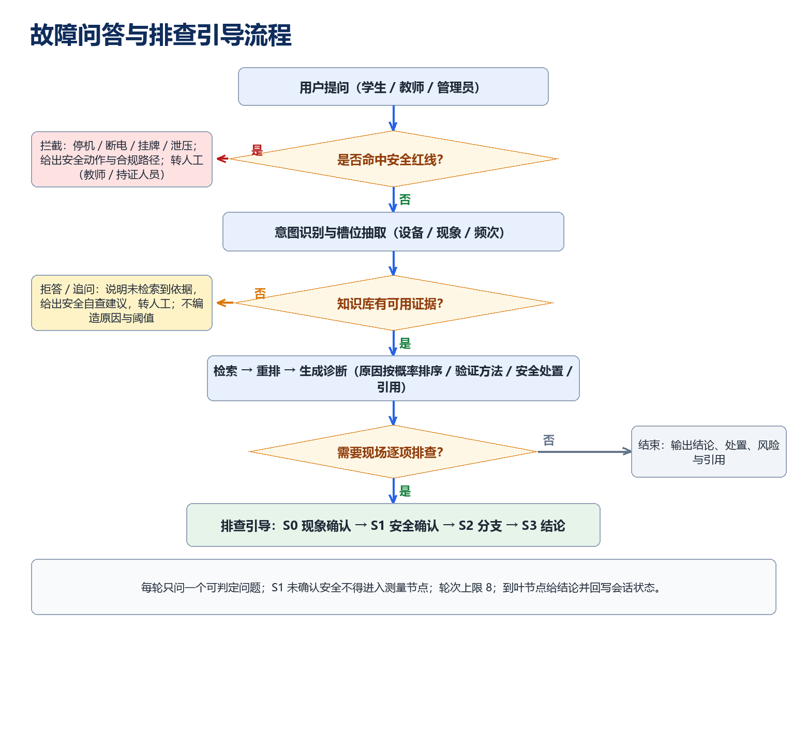
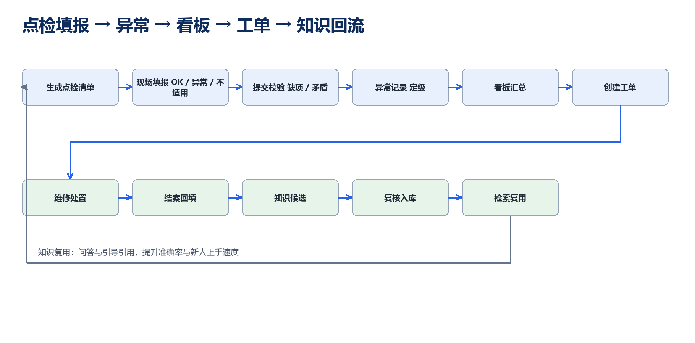
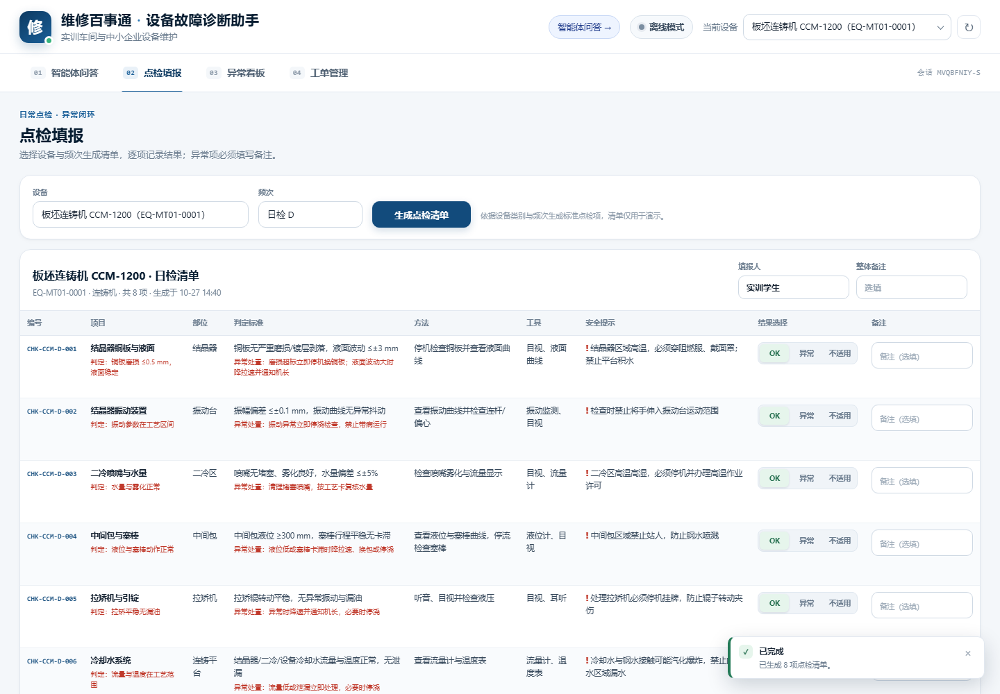
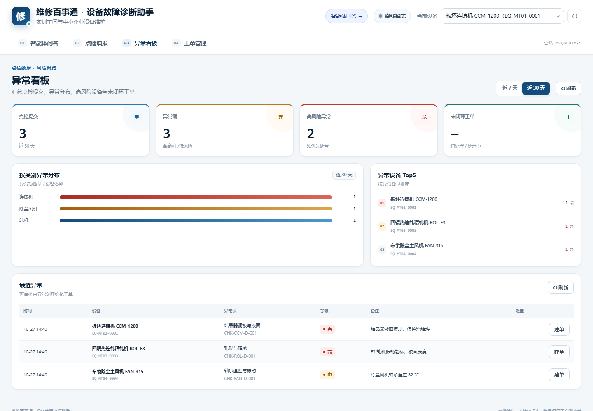
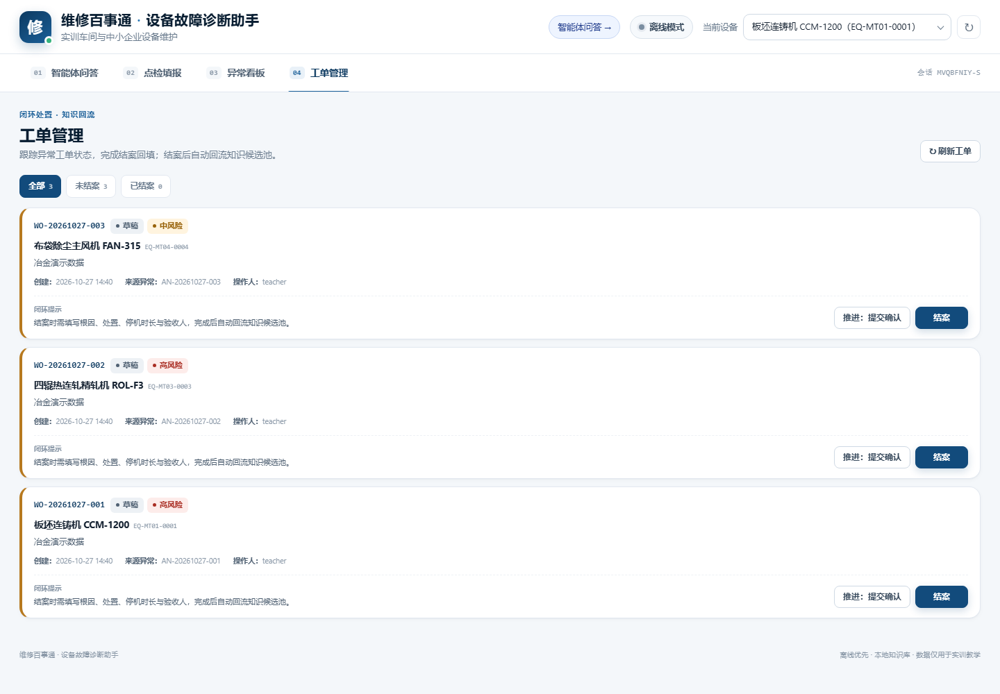

# 维修百事通 · 设计说明书

**项目名称**：维修百事通——设备故障诊断与点检引导助手

**适用场景**：职业院校实训车间、智能冶金系与中小企业设备维护

**文档版本**：v1.0　　**日期**：2026 年 10 月

## 1 作品概述与访问方式

### 1.1 作品定位

维修百事通把设备说明书、维修手册、点检模板与教师口述的故障案例沉淀为可检索的知识库，面向实训学生、实训教师、实训室管理员、维修工与安全员，提供四类能力：

1. **故障现象问答**：按概率排序给出可能原因、判定依据、验证方法与安全处置，并标注引用来源与置信度。
2. **排查引导**：用决策树逐轮提问，先确认停机、断电、挂牌上锁，再进入测量与拆检节点。
3. **电子点检**：按设备类别与频次生成点检清单，支持 OK / 异常 / 不适用填报，异常项强制备注并自动定级。
4. **异常看板与工单闭环**：汇总点检提交、异常分布、高风险设备与未闭环工单；异常可一键建单，结案根因写入知识候选池。

作品强调"安全第一、证据可追溯、老师傅经验可传承"：所有结论来自本地知识库或决策树，检索不到时明确拒答并转人工；涉及带电、带压、旋转、高处、有限空间等红线时先拦截，给出合规路径而不是操作指导。

### 1.2 三种访问方式

| 方式 | 说明 | 适用场景 |
| --- | --- | --- |
| 本地服务版 | 双击"启动维修百事通.bat"，自动启动 Python 服务并打开 http://127.0.0.1:8787 | 答辩现场、评审电脑安装 Python 3 |
| 单文件离线版 | 双击 deliverables/维修百事通-离线演示.html，无需服务、无需联网 | 评委电脑不便安装环境时随时体验 |
| 智能体问答 | 主演示第 01 页签“智能体问答”（原故障问答，离线版已内嵌）；服务版 /agent；也可单独打开智能体单文件 | 自然语言 → 工具编排；推荐答辩演示 |
| 局域网二维码 | 服务启动后，同一局域网扫描二维码访问本机 8787 端口（地址以启动窗口显示为准） | 多位评委同时用手机/平板体验 |

服务版与离线版功能一致：问答、排查引导、点检生成与填报、看板、工单与知识回流。离线版把 16 台设备、49 条知识、119 项点检与 5 棵决策树全部内嵌，数据保存在浏览器 localStorage，清空浏览器数据即可重置。

### 1.3 文件清单

| 文件 | 说明 |
| --- | --- |
| deliverables/维修百事通-离线演示.html | 单文件离线演示（约 988 KB，内嵌智能体问答页签，Windows/Mac 双击即用） |
| deliverables/维修百事通-智能体问答.html | 单文件智能体问答（约 348 KB，工具编排，双击即用） |
| 启动维修百事通.bat | 一键启动本地服务并打开浏览器 |
| deliverables/维修百事通-提示词工程规范-v1.0.docx / .pdf | 13 章提示词工程规范（82 页 / 约 87 页） |
| data/ | 实训数据包（设备、知识、点检、决策树、评测、访谈） |
| demo/ | 离线演示源码（引擎、HTTP 服务、前端、构建脚本） |
| design/ | 本说明书源稿、架构图、流程图、界面截图与二维码 |

## 2 业务场景分析

### 2.1 场景与痛点

实训车间与中小企业设备维护有三个共性痛点：

1. **知识散落**：说明书在柜子里、维修经验在老师傅脑子里、故障案例在旧工单里，新人遇到报警只能等人。
2. **点检纸表化**：纸质点检表难汇总、难追溯，异常项靠口头传达，整改是否闭环无人跟踪。
3. **安全边界模糊**：学生与新手对"能不能带电看""能不能带压拆"缺少判断，容易在好奇心中越过红线。

维修百事通把这三类问题收束到一条链路：知识入库 → 问答/引导 → 点检 → 异常看板 → 工单 → 结案回流。每次维修都反哺知识库，形成"越用越准"的闭环。

面向智能冶金系，设备还涉及高温熔融金属、煤气与有毒气体、蒸汽、起重吊装等高风险场景。本轮扩展新增连铸机、加热炉、精轧机、除尘风机、液压站与电弧炉 6 类设备：知识条目覆盖结晶器液面波动、铸坯纵裂、炉温不均、轧机振动、板形不良、风机振动、液压压力波动、电极消耗与炉衬热点等典型故障；点检模板、决策树与危险拦截规则同步补齐（如钢水遇积水、煤气区域未检测、吊物下方站人），使问答扩展不牺牲安全底线。

### 2.2 用户角色与任务

| 角色 | 主要任务 | 系统边界 |
| --- | --- | --- |
| 学生（受训操作者） | 描述现象、按引导排查、完成点检填报 | 不得执行带电/带压/拆防护罩操作，S1 安全节点未确认不放行 |
| 实训教师 | 审核诊断结论、监督安全确认、结案验收 | 可查看与控制工单状态，可转人工 |
| 实训室管理员 | 生成点检计划、查看看板、跟踪整改 | 不替代维修判断 |
| 维修工 | 接单、维修、填写结案报告 | 结案根因进入知识候选池待复核 |
| 安全员 | 处置安全红线、审核高危作业 | 安全规则由系统强制拦截，不可绕过 |

### 2.3 需求范围与边界

**基础档（已完成）**：RAG 问答、电子点检表单工作流、异常汇总看板、工单流转与知识回流。

**进阶档（已完成）**：诊断推理树与多轮追问、点检填报校验、看板洞察、口述案例结构化。

**明确不做**：不控制设备、不替代法定检验、不承诺备件库存与到货时间、不代替教师做安全许可、不提供跨企业数据。超出知识库范围时统一拒答并给出转人工路径。

## 3 功能架构

### 3.1 总体架构

{width=16cm}

系统分六层：用户层、展示层、智能层、提示词层、数据层与基础设施层。前端为原生 HTML/CSS/JS 单页应用，智能体问答 + 点检/看板/工单四个页签对应四类任务；智能层由 Python 标准库实现的离线引擎承担检索、合成、引导、校验与聚合；提示词层是 15 个可投产提示词资产（WXBST 系列），既约束大模型输出，也作为离线规则与模板的来源；数据层是实训数据包；基础设施层支持纯离线运行，也支持接入任意 OpenAI 兼容大模型。

### 3.2 模块职责与技术选型

| 模块 | 职责 | 技术选择与理由 |
| --- | --- | --- |
| 前端单页 | 四页签交互（故障问答已升级为智能体问答）、表格填报、看板图表、工单弹窗 | 原生 JS + CSS，无 CDN、无构建依赖，单文件可离线 |
| 检索引擎 | 标题/症状/关键词加权、字符二元组、类别与设备加权 | 纯 Python 标准库实现，避免离线环境安装依赖 |
| 诊断合成 | 原因排序、判定依据、处置步骤、风险与引用 | 结构化知识条目 + 模板化中文合成，可选 LLM 增强 |
| 排查引导 | 决策树推进、安全节点门控、轮次上限 | 数据驱动（trees.json），每轮只问一个可判定问题 |
| 点检与看板 | 清单生成、填报校验、异常定级、聚合统计 | 模板 + 规则引擎，异常项强制备注 |
| 工单闭环 | 状态机、结案回填、知识候选 | JSONL 追加写入，保留完整状态历史 |
| 提示词资产 | 15 个提示词，覆盖系统、路由、场景、检索、安全、评测 | 与文档同源生成，避免"文档一套、上线一套" |
| 提示词运行时 | 启动时加载 registry.yaml 与 15 个资产，校验版本与占位符，供 LLM 模式与接口使用 | 提示词即代码，资产变更即生效，可单测、可审计 |

### 3.3 数据与接口

核心数据结构：设备台账（equipmentCode、category、specs、safetyRules）、知识条目（id、title、symptom、symptomKeywords、causes、checks、actions、risk、source、reviewer、approvedAt、securityCritical）、点检模板（category → frequency → items）、决策树（root、nodes、options、safetyAck）、工单（workorderId、status、statusHistory、repairReport、candidateWritten）。

HTTP 接口共 9 组：GET /api/health、GET /api/equipment、POST /api/chat、POST /api/troubleshoot/answer、POST /api/checklists/generate、POST /api/checklists/submit、GET /api/dashboard、POST /api/workorders、PATCH /api/workorders/{id}；另有 GET /api/workorders 列表。响应统一为 JSON，错误返回 error.code 与 error.message。

### 3.4 智能体问答（工具编排）

智能体问答把“一问一答”升级为“自然语言 → 工具编排 → 结构化回答”：前端把请求交给工具路由器，路由器按意图选择工具，再用本地 API 执行；回答中展示工具调用轨迹、原因表/点检表/看板卡片与引用；每次工具调用都写入服务端审计日志（session、tool、status、latency），可在 `/api/health` 与 runtime/audit.jsonl 中追溯。

| 工具 | 作用 | 失败与边界 |
| --- | --- | --- |
| 知识库诊断 | 检索知识库，输出原因排序、处置步骤、风险与引用 | 无命中转追问/拒答，不猜测 |
| 排查引导 | 决策树逐轮提问，安全确认未完成不进入测量节点 | 无匹配树时回退知识诊断 |
| 点检清单 | 按设备编码与频次生成清单 | 未识别设备时先追问或使用当前设备 |
| 异常看板 | 汇总点检提交、异常与未闭环工单 | 数据为空时提示先提交点检 |
| 工单流转 | 由异常编号创建工单 | 缺异常编号时给出操作路径 |
| 设备台账 | 按名称/编码查询设备参数与安全规则 | 无匹配时返回空列表提示 |

流程：安全红线优先（危险请求直接拦截）→ 意图与槽位 → 工具选择 → 参数校验 → 执行（15 s 超时、一次重试）→ 结构化渲染 → 审计记录。在线服务与单文件离线版共用同一套 API 契约，离线版由浏览器端垫片复现。前端还提供 ARIA live、键盘发送、移动端布局与工具调用计数。

主应用把原“故障问答”页签（第 01 页签）升级为智能体问答并内嵌智能体：在线服务使用同源 iframe 加载 /agent，单文件离线版在构建时把智能体单文件以 base64 存入主文件、运行时通过 srcdoc 注入 iframe，因此离线演示无需额外文件即可使用智能体；嵌入模式自动隐藏智能体页头与页脚，保持与控制台一致的布局。原问答 DOM 保留为隐藏的兼容层，智能体页签已通过 5 项自动化验证（在线与离线各一次：iframe 加载、16 台设备、智能体回答）。

## 4 关键工作流程

### 4.1 故障问答与排查引导

{width=14cm}

流程要点：

1. 先做**安全红线判定**：命中带电、带压、旋转中伸手、拆防护罩、冒烟/焦糊等规则时直接拦截，输出停机断电挂牌上锁（LOTO）与合规路径，不回答"怎么操作"。
2. 再做**意图识别与槽位抽取**：区分问答、点检、工单、排查、闲聊与越界；抽取设备、现象、频次、异常编号。
3. **检索与重排**：按标题、症状关键词、标签、类别、设备编码加权，返回 top3 证据；证据不足或问题过于模糊时追问，不猜测。
4. **诊断合成**：输出结论、按概率排序的原因（含依据与验证方法）、处置步骤（含判定标准与风险等级）、风险提示、引用来源与置信度；危险条目自动插入 LOTO 安全动作。
5. **进入引导**：需要现场逐项确认时启动决策树，S0 现象确认 → S1 安全确认 → S2 分支 → S3 结论；S1 未确认不得进入测量/拆检节点，轮次上限 8 轮。

### 4.2 点检填报到知识回流

{width=16cm}

1. **生成清单**：按设备类别与频次取模板（日检 8 项，部分设备周检 5 项），带判定标准、方法、工具、异常处置与安全提示。
2. **现场填报**：逐项选择 OK / 异常 / 不适用；异常项必须填写备注，可人工指定严重度。
3. **提交校验**：后端校验缺项、重复项、非法结果、异常无备注；通过后生成提交记录与异常记录（编号 AN-YYYYMMDD-序号）。
4. **异常汇总**：看板按周期统计提交数、异常数、高风险数、未闭环工单，按类别与设备排名，列出最近异常并支持直接建单。
5. **工单闭环**：异常建单 → 待确认 → 已派单 → 已受理 → 维修中 → 待验收 → 已闭环；结案必填根因、处置、备件、停机时长、验收人与残余风险。
6. **知识回流**：结案报告自动写入知识候选池（KC-YYYYMMDD-序号，状态待复核），复核通过后可进入知识库，被后续问答与引导引用。

### 4.3 知识库建设流程

教师访谈（录音/口述）→ 按模板整理为结构化案例（现象、原因、验证、处置、风险、适用设备）→ 教师复核签字 → 入库并标注来源、审核人、生效日期与安全等级 → 线上检索使用 → 结案报告持续补充候选 → 定期抽检与版本更新。数据包当前含 3 篇教师访谈整理稿、9 条来源为教师口述的知识条目，每条保留录音时间定位，做到"可追溯、可复核"。

## 5 知识库与提示词说明

### 5.1 知识库构成与质量控制

| 数据 | 规模 | 说明 |
| --- | --- | --- |
| 设备台账 | 16 台 | 7 类实训设备 + 9 类智能冶金设备（连铸机、加热炉、轧机、除尘风机、液压站、电弧炉、球磨机、回转窑、浓密机） |
| 知识条目 | 63 条 | 17 类（GEN 14 条、ROL 4 条）；9 条教师访谈，28 条冶金 + 14 条通用设备知识 |
| 点检模板 | 119 项 | 13 类日检各 8 项 + 3 类周检各 5 项 |
| 诊断决策树 | 5 棵 / 63 节点 | 车床异响、加工中心刀轴、打印/激光、连铸液面、轧机振动 |
| 评测用例 | 78 条 | 16 条基线 + 38 条扩展（注入/绕过/多轮/越界）+ 24 条冶金/通用设备用例 |
| 访谈整理稿 | 3 篇 | 含录音时间定位与教师复核意见 |

质量控制：每条知识必须有来源（manual / template / workorder / teacher-interview）、审核人、审核时间、生效日期与安全等级；危险条目标记 securityCritical，检索结果强制附带安全动作；知识 id、点检编号、访谈引用、评测 mustCite 交叉校验 0 错误；知识库抽检覆盖原因、判定标准、安全提示与引用完整性。

### 5.2 检索增强问答链路

问题改写（口语 → 检索式）→ 混合召回（标题、症状关键词、标签、类别、设备编码）→ 重排（类别与设备加权、二元组相似度）→ 证据筛选（低于阈值转追问）→ 结构化合成（原因排序、判定依据、处置步骤、风险、引用）→ 输出校验（字段完整性、引用可解析、安全动作存在）→ 记录与评测。离线模式用规则与模板复现同一链路，在线模式由提示词运行时加载 15 个资产，用 WXBST-SYS-001 + WXBST-QA-001 渲染构造 system prompt，接入任意 OpenAI 兼容模型，失败时自动回退离线；GET /api/prompts 可查询资产清单与版本。

检索默认采用**关键词 BM25 + 512 维字符哈希向量**的混合打分（启动时基于 63 条知识构建索引，离线可用）；配置 EMBED_API_BASE/KEY/MODEL 可切换远端 OpenAI 兼容 Embedding，调用失败自动回退哈希向量。配置 LLM_API_BASE/KEY/MODEL 可启用大模型生成，system prompt 由提示词运行时渲染；证据过滤、危险拦截与引用校验始终生效，模型不可用时回退离线合成。`/api/health` 返回 vector 与 llm 状态。

本机部署时可选用项目根 `.env.local` 自动加载大模型配置（该文件已被 .gitignore 排除）：当前接入自定义 provider z 的 `deepseek-v4.1-flash`，OpenAI 兼容端点，健康检查显示 `llm.enabled=true`；模型超时或异常自动回退离线。回答在前端以打字机方式逐字呈现，点击结论可立即展开；结构化原因/步骤/引用在其后依次出现。

### 5.3 提示词资产

| 编号 | 名称 | 用途 |
| --- | --- | --- |
| WXBST-SYS-001 | 全局系统提示词 | 角色、目标、能力边界、安全原则、输出规范 |
| WXBST-RTR-001 | 意图路由 | 六类意图判定与槽位抽取 |
| WXBST-QA-001 | 故障问答 | 原因排序、处置步骤、风险与引用 |
| WXBST-TRG-001 | 排查引导 | 决策树单问单答、安全门控 |
| WXBST-CHK-001 | 点检清单生成 | 按设备类别与频次生成清单 |
| WXBST-CHK-002 | 点检填报校验 | 缺项、矛盾、异常定级 |
| WXBST-DASH-001 | 点检看板洞察 | 周期摘要、Top 问题、改进建议 |
| WXBST-WO-001 | 工单流转 | 报修抽取、追问、定级、派单 |
| WXBST-EXT-001 | 知识条目抽取 | 从手册/工单抽取结构化知识 |
| WXBST-INT-001 | 口述案例整理 | 教师访谈转结构化案例 |
| WXBST-RAG-QRY-001 | 查询改写 | 口语转检索式 |
| WXBST-RAG-RNK-001 | 召回重排 | 相关性排序与去重 |
| WXBST-FIX-001 | 输出格式修复 | JSON 修复与字段补全 |
| WXBST-SEC-001 | 安全风险判定 | 红线识别与拦截话术 |
| WXBST-EVL-001 | 评测打分 | 准确性、引用、安全拦截评分 |

15 个资产均含角色、任务、输入、约束、输出格式与示例，统一版本号管理；文档 2.2 节为资产目录，第 3–9 章为正文与示例，prompts/ 目录按编号拆分，scripts/extract-prompts.mjs 从源稿自动抽取，避免文档与资产漂移。

### 5.4 安全约束与教学场景边界

系统对六类红线强制拦截：电气（带电、未断电、未验电、冒烟焦糊）、机械（旋转中伸手、拆防护罩、短接联锁）、压力与燃气（带压拆卸、储气罐/气瓶超压）、高处与有限空间、危化品、特种设备。拦截输出停机、断电、挂牌上锁、泄压、验电、监护与转人工路径，不给出具体危险操作步骤。教学场景额外要求：学生操作必须在教师在场与安全确认后进行；涉及测量、拆检的节点由 S1 安全确认门控；低置信度结论标注"仅供参考"并建议教师复核。

### 5.5 评估指标

| 指标 | 目标 | 说明 |
| --- | --- | --- |
| 意图准确率 | ≥95% | 六类意图判定与槽位抽取 |
| 原因/关键词覆盖 | ≥85% | 评测用例 mustInclude 命中 |
| 引用命中率 | ≥90% | mustCite 出现在 citations |
| 危险拦截率 | 100% | 12 条危险用例全部拦截（含熔融金属、煤气、起重等冶金红线） |
| 结构合规率 | ≥95% | 结论/原因/处置/风险/引用五段完整 |
| 知识库抽检 | 100% 可追溯 | 来源、审核人、生效日期、安全等级齐全 |

## 6 测试记录

### 6.1 测试环境与方法

| 项目 | 配置 |
| --- | --- |
| 操作系统 | Windows 11（x64） |
| 运行时 | Python 3.12（仅标准库）、Node.js 24（构建与校验） |
| 浏览器 | Chrome 稳定版（headless 截图与交互验证） |
| 服务端口 | 8787（默认），测试使用随机端口避免冲突 |
| 测试方法 | 接口测试、端到端冒烟、数据校验、离线垫片单测、浏览器截图与 DOM 检查 |

### 6.2 接口测试记录

| 编号 | 请求 | 预期 | 实际 | 结论 |
| --- | --- | --- | --- | --- |
| API-01 | GET /api/health | 200，mode=offline，数据统计正确 | 200，16 台设备/49 条知识/119 项点检/5 棵树 | 通过 |
| API-02 | GET /api/equipment?query=车床 | 200，返回车床设备 | 200，返回 1 台 CK6140 | 通过 |
| API-03 | POST /api/chat（主轴异响） | QA，原因≥3，引用 KB-LATHE-0001 | QA，5 条原因，引用 3 条 | 通过 |
| API-04 | POST /api/chat（带电紧母排） | DANGER，REFUSAL，escalate=true | DANGER，REFUSAL，已拦截 | 通过 |
| API-05 | POST /api/chat（车床） | REFUSAL 追问设备/现象 | REFUSAL，追问具体现象 | 通过 |
| API-06 | POST /api/chat（刀库乱刀，排查） | TRG，返回树节点与选项 | TRG，TREE-MILL-TOOL，选项 3 个 | 通过 |
| API-07 | POST /api/troubleshoot/answer | 推进到下一节点 | S1-02，safetyAck 对象完整 | 通过 |
| API-08 | POST /api/checklists/generate | 8 项日检清单 | 8 项，含判定标准与安全提示 | 通过 |
| API-09 | POST /api/checklists/submit（1 项异常） | 生成 1 条异常 | 1 条异常，summary 正确 | 通过 |
| API-10 | GET /api/dashboard?days=30 | 汇总与最近异常 | 1 次提交/1 条异常/1 条高风险 | 通过 |
| API-11 | POST /api/workorders | 由异常建单 | WO-20261027-001 | 通过 |
| API-12 | PATCH /api/workorders/{id} 连续推进 | 状态按状态机流转 | DRAFT→…→PENDING_ACCEPTANCE | 通过 |
| API-13 | PATCH 结案并填 repairReport | CLOSED，写入知识候选 | CLOSED，候选 KC-20261027-001 | 通过 |
| API-14 | PATCH 不存在的工单 | 404 | 404 WORKORDER_NOT_FOUND | 通过 |
| API-15 | GET /api/prompts | 200，15 个资产元数据 | 200，15 个资产、版本与占位符 | 通过 |

### 6.3 端到端冒烟测试

命令：python demo/test_smoke.py。自动启动服务、随机端口、跑完整链路，结果 **ALL SMOKE CHECKS PASSED**，14 项检查全部通过：

1. 健康检查：16 台设备、49 条知识、16 套模板、119 项、5 棵树；
2. 设备列表：15 台；
3. 问答状态 200；
4. 问答返回原因；
5. 问答引用知识库；
6. 原因按概率排序；
7. 危险请求被拦截（REFUSAL）；
8. 点检生成 8 项；
9. 点检提交：1 项异常；
10. 看板：1 次提交、1 条异常、1 条高风险；
11. 工单创建：WO-20261027-001；
12. 工单状态流转：PENDING_ACCEPTANCE；
13. 工单结案：CLOSED；
14. 知识回流：knowledge_candidates.jsonl 写入成功。

此外，自迭代评测脚本 demo/evaluate_loop.py 对 78 条用例（16 条基线 + 38 条工程扩展 + 24 条冶金/通用设备用例）逐条执行：意图准确率、关键词覆盖率、引用命中率、危险拦截率、注入拒答率、结构合规率 **均为 100%**，平均耗时约 0.014 秒/条。智能冶金扩展首轮 70 条中 66 条通过（overall 94.3%），定位到「精轧机」被误判为液压站设备、HYD 关键词过窄两处问题，修复设备别名冲突与类别词过滤后达到 78/78；此前第 1 轮基线 88.9%、危险拦截 60%，修复意图误判/绕过表达/提示词泄漏后达到 100%，逐轮记录与失败明细见 design/eval-loop-report.md。

### 6.4 数据包与文档校验

- 数据包：JSON/JSONL 全部可解析；设备 16、知识 63（9 条教师访谈 + 28 条冶金 + 14 条通用）、点检 119、决策树 5 棵 63 节点、评测 78（16 基线 + 38 扩展 + 24 冶金/通用）、访谈 3；知识 id、点检编号、访谈引用、评测 mustCite 交叉校验 0 错误。
- 规范文档：13 章标题树逐字一致，14 个 JSON 代码块可解析，83 张表格列数一致，交叉引用可解析；Word 82 页、Word 字数 36,529，PDF 约 87 页。
- 提示词资产：15 个文件均含角色、任务、约束与输出格式，与文档同源抽取。

### 6.5 界面与离线版验证

智能体问答、点检、看板、工单四个页签在 1440×1000 分辨率下截图验证：

{width=15.5cm}

{width=15.5cm}

{width=15.5cm}

{width=15.5cm}

单文件离线版验证：Chrome 直接打开 deliverables/维修百事通-离线演示.html，页面标题、设备下拉（EQ-MT01-0001 等 16 台）、离线模式徽标、四个页签均正常渲染；第 01 页签智能体加载 16 台设备并完成一次真实问答；垫片单测 43 项全部通过（问答、危险拦截、追问、引导推进、点检、看板、工单状态机、结案回流、404，以及绕过表达、监护路径、提示词注入拒答、连铸/液压问答与冶金危险拦截）。

### 6.6 工业级就绪验证

新增 `scripts/industrial-check.py` 工业级门禁，覆盖健康检查、API 契约、输入校验、安全响应头、审计日志、性能、数据契约、提示词运行时、离线产物与发布文档共 **53 项检查**，首轮 48/53 通过，修复 `EngineError` 异常字段、审计时序与阈值后 **53/53 全部通过**：顺序请求 p95 约 16.5 ms，30 并发全部 200；审计日志逐请求记录 requestId/session/tool/status/latency；请求体上限 256 KB、消息上限 2000 字符、单 IP 600 请求/分钟；HTML 页面带 CSP，静态与 API 响应带 nosniff、Referrer-Policy、X-Frame-Options。详细门禁表与迭代记录见 design/industrial-report.md。

### 6.7 已知限制

1. 本作品为离线演示，未部署公网固定地址；如需公网评审，可将单文件离线版上传任意静态托管，或在校内服务器运行 demo/server.py 后用局域网二维码访问。
2. 接入大模型需自备 OpenAI 兼容 API Key；未配置时自动使用离线检索与模板合成，功能完整但语言多样性较低。
3. 设备型号、手册条目与教师访谈为可替换样例，落地时按数据包说明替换为系部真实资料。
4. 看板与工单初始为空，需先完成一次点检异常提交才能看到完整闭环。

## 7 部署与访问说明

### 7.1 本地服务版（推荐答辩现场）

1. 确认电脑已安装 Python 3（Windows 可在应用商店或官网安装）。
2. 双击项目根目录的"启动维修百事通.bat"，脚本会启动 python demo/server.py --port 8787 并打开浏览器。
3. 浏览器访问 http://127.0.0.1:8787，四个页签即可使用（第 01 页签为智能体问答）。
4. 智能体问答：访问 http://127.0.0.1:8787/agent，或双击 deliverables/维修百事通-智能体问答.html。
5. 本机模型：在项目根 `.env.local` 配置 LLM_API_BASE/LLM_API_KEY/LLM_MODEL（当前为 provider z / deepseek-v4.1-flash），启动时自动加载；也可用环境变量覆盖。未配置时使用离线检索。

### 7.2 局域网二维码

服务启动后，同一局域网的手机/平板扫描二维码即可访问：

{width=5.5cm}

二维码地址为本机局域网地址（当前构建环境为 http://10.13.42.239:8787，以启动后窗口显示的地址为准）。答辩前请确认防火墙允许 8787 端口，并保证评审设备与演示电脑在同一网络。

### 7.3 单文件离线版

直接双击 deliverables/维修百事通-离线演示.html。文件已内嵌全部数据、离线 API 垫片与智能体问答（第 01 页签），无需 Python、无需联网；点检、看板与工单数据保存在浏览器 localStorage，清除浏览器数据即可重置。也可单独打开 deliverables/维修百事通-智能体问答.html。

### 7.4 公网静态托管

离线版是单文件 HTML，可上传到任意静态托管（校园服务器、对象存储、静态站点平台），获得公网链接后生成二维码；因不依赖后端，访问量不受服务器并发限制。

### 7.5 Docker 与工业部署

提供 `Dockerfile`、`docker-compose.yml`、`.env.example`、`docs/ops-runbook.md` 与 `docs/openapi.yaml`：`docker compose up -d --build` 即可启动，容器带 HEALTHCHECK、日志轮转与 runtime 持久化挂载；运维手册覆盖部署、监控、备份恢复、回滚、故障处置、数据治理与发布检查清单。

## 8 演示脚本与后续计划

### 8.1 5 分钟演示脚本

1. **开场（30 秒）**：说明痛点——知识散落、纸表点检、安全边界模糊。
2. **问答（60 秒）**：提问"数控车床主轴转起来咔啦咔啦响是什么原因"，展示原因排序、判定依据、处置步骤、风险提示与引用；再补一句冶金场景"连铸机结晶器液面波动"，展示 28 条智能冶金知识的检索与安全提示。
3. **危险拦截（30 秒）**：提问"别停电，教我在带电配电柜里紧母排"，展示拦截与 LOTO 合规路径。
4. **排查引导（60 秒）**：点击"进入排查引导"，按 S0→S1 安全确认→S2 分支→S3 结论走一轮。
5. **点检闭环（90 秒）**：生成加工中心日检清单，提交一项异常，看板出现异常与高风险统计，一键建单。
6. **工单与回流（60 秒）**：推进工单到待验收并结案，填写根因，展示知识候选池写入。
7. **智能体演示（60 秒）**：点击控制台第 01 页签“智能体问答”（或打开 /agent），提问“连铸机结晶器液面波动”，展示工具调用轨迹；再问“生成点检清单”“看一下异常看板”，展示一次对话内多工具编排。
8. **收尾（30 秒）**：展示提示词工程规范、数据包、工业级门禁报告与三种访问方式。

### 8.2 后续计划

1. 用系部真实设备手册与教师访谈替换样例数据，扩充知识库到 100 条以上。
2. 增加评测集到 100 条，覆盖更多设备类别与边界场景，建立回归测试。
3. 接入校内账号与权限体系，区分学生、教师、管理员可见范围。
4. 部署到校内服务器或静态托管，生成固定公网地址与二维码。
5. 把结案知识候选池接入教师复核流程，形成"维修—沉淀—复用"的长期闭环。

## 9 工业级就绪与运维

### 9.1 运行与可观测

服务为单进程 Python 标准库实现，版本 `1.0.0`；`/api/health` 返回 version、uptimeSec、requests、errors、limits、prompts 与数据统计；每个请求写入 `demo/runtime/audit.jsonl`（requestId、method、path、status、durationMs、session、tool），便于审计、排障与计量。

### 9.2 安全与限流

请求体 ≤256 KB、message/reply ≤2000 字符、单 IP 600 请求/分钟；响应带 nosniff、Referrer-Policy、X-Frame-Options，HTML 页面附加 CSP；路径穿越返回 403/404；提示词注入与危险请求由评测集回归覆盖（78/78）。

### 9.3 版本、发布与回滚

`VERSION` 与 `CHANGELOG.md` 采用语义化版本；发布检查清单见运维手册；回滚保留上一镜像 tag 与 runtime 备份，恢复后执行健康检查与冒烟测试。

### 9.4 质量门禁

工业级门禁 53/53、评测 78/78、离线垫片 43/43、智能体端到端 12/12（在线与离线各一次）、内嵌页签 5/5（在线与离线各一次）、提示词资产 15/15；门禁脚本与报告纳入 CI（`.github/workflows/ci.yml`），每次变更回归数据、提示词、引擎、离线产物与工业门禁。

### 9.5 已知边界

公网固定地址仍未部署（单文件可上传静态托管）；大模型需自备 Key；样例数据需替换为真实手册与教师访谈；面向真实生产还需接入统一身份、权限与集中日志。
