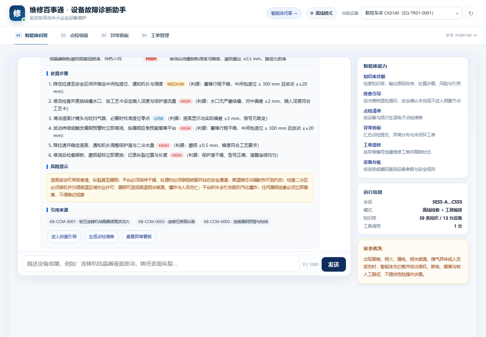
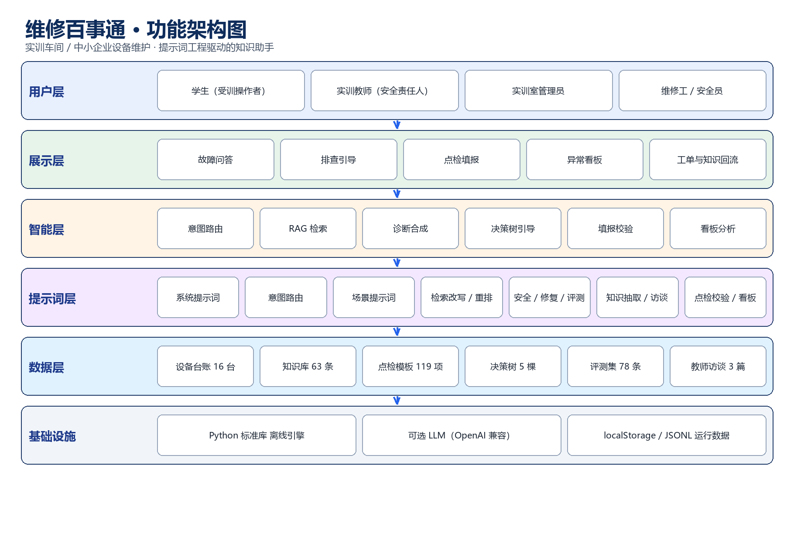

# 一、项目背景

实训车间与中小企业设备维护高度依赖“老师傅经验”：设备说明书、维修手册、故障案例分散在纸质文档和个人经验中，新人排查慢、处置不规范、点检记录难闭环；教师口述的现场经验也缺少结构化沉淀。与此同时，通用大模型直接回答设备问题容易编造参数、引用不可追溯，不能直接用于现场。

本项目把设备手册、维修案例与教师访谈沉淀为可检索知识库，用智能体编排诊断、点检、看板与工单工具，做到“回答有依据、步骤可执行、风险有提示、数据可回流”。

# 二、目标用户与场景

- **实训学生**：故障现象问答、排查引导、电子点检填报；
- **实训教师/设备管理员**：异常看板、工单派发与结案、知识复核；
- **中小企业设备班组**：点检标准化、故障经验留存、维修工单闭环；
- **智能冶金方向**：连铸、加热炉、轧机、除尘、液压、电弧炉、球磨机、回转窑、浓密机等设备与工艺问答。

# 三、作品形态与核心功能

作品形态为**智能体 + 应用原型**：自然语言输入后，由工具路由器选择并调用本地工具，回答中展示工具调用轨迹与知识引用。

| 工具 | 能力 |
| --- | --- |
| 知识库诊断 | 原因排序、判定依据、处置步骤、风险与引用 |
| 排查引导 | 决策树逐轮提问，安全确认未完成不进入测量节点 |
| 点检清单 | 按设备与频次生成电子清单，提交异常自动汇总 |
| 异常看板 | 点检提交、异常分布、未闭环工单统计 |
| 工单流转 | 异常建单、状态流转、结案知识回流 |
| 设备台账 | 设备参数、安全规则与常见故障查询 |

{width=16cm}

# 四、技术方案

- **前端**：原生 HTML/CSS/JS 单页应用，无第三方依赖；控制台第 01 页签即智能体问答；
- **领域引擎**：Python 标准库实现检索、合成、引导、校验与聚合；
- **检索增强**：关键词 BM25 + 512 维字符哈希向量混合召回，支持类目/设备加权；可切换远端 Embedding；
- **大模型**：可选接入自定义模型 Z（deepseek-v4.1-flash）生成，提示词运行时加载 WXBST-SYS-001 + WXBST-QA-001；模型异常自动回退离线；
- **安全**：危险请求拦截、提示词注入防护、引用校验、审计与限流；
- **产品化**：SQLite WAL 持久化、Token 鉴权、请求 ID、/api/ready 与 /api/metrics、备份恢复、Docker/nginx/systemd。

{width=16cm}

# 五、数据与验证

| 维度 | 规模 |
| --- | --- |
| 设备台账 | 16 台（7 类实训 + 9 类智能冶金） |
| 知识条目 | 63 条（含 28 条智能冶金、14 条通用设备） |
| 点检模板 | 119 项 |
| 诊断决策树 | 5 棵 / 63 节点 |
| 评测用例 | 78 条 |

验证结果：评测 78/78、离线垫片 43/43、工业门禁 53/53、生产基础验收 31/31；危险请求拦截与提示词注入拒答均为 100%。

# 六、产品化进展

R1 已完成从演示到产品化基础能力的改造：配置校验、SQLite 事务持久化与旧 JSONL 迁移、Token 鉴权 + 角色、请求 ID/审计入库、就绪与指标接口、在线备份/恢复、非 root 只读容器与 nginx 反向代理、systemd 备份定时器。

# 七、演示与交付

- 本机服务：http://127.0.0.1:8787；智能体页：/agent；
- 单文件离线版：双击 HTML 即可运行，适合无网环境；
- 演示视频/截图：控制台、智能体页、点检、看板、工单；
- 源码、数据包、设计说明书、提示词规范与产品化文档随项目提交。

# 八、团队分工与计划

| 角色 | 工作 |
| --- | --- |
| 组长 | 需求、知识库、智能体编排、答辩 |
| 成员 A | 前端交互、点检/看板、测试 |
| 成员 B | 检索引擎、数据整理、部署与运维 |
| 指导教师 | 场景审核、知识复核、安全把关 |

下一阶段：应用级登录/RBAC、知识版本与审核发布、PostgreSQL/多实例、压测与 SLO、示范班级试点。

# 九、应用价值

1. 把“老师傅经验”变成可检索、可追溯、可复用的知识资产；
2. 让新人按步骤排查，危险场景先停机断电，降低误操作；
3. 点检—异常—工单—知识回流形成闭环，管理可量化；
4. 离线可运行、低成本部署，适合实训室与中小企业起步使用。

# 十、风险与应对

| 风险 | 应对 |
| --- | --- |
| 知识来源不真实或过期 | 每条知识带来源、审核人、生效日期；双人复核，过期条目下架不删除 |
| 大模型编造参数 | 证据过滤 + 引用校验 + 安全拦截；模型异常自动回退离线规则与模板 |
| 现场操作安全 | 危险请求先停机断电；排查树设安全确认门；高风险动作要求教师/值班人员确认 |
| 部署与运维门槛 | 提供单文件离线版、Docker/nginx/systemd 与备份脚本；生产基线含 SQLite 持久化、Token 鉴权、就绪与指标 |
| 数据隐私 | 仅使用教学样例与公开手册；访谈稿匿名化，不采集真实企业敏感数据 |

# 十一、预期成果与可持续

- **教学成果**：形成 1 套可复用的实训故障诊断与点检案例，支持 3 个班级试点；
- **知识资产**：扩充至 100 条以上设备与工艺知识，建立教师审核与版本发布流程；
- **技术演进**：R2 完成应用登录/RBAC 与 CI 生产门禁，R3 支持 PostgreSQL/多实例与压测；
- **运营机制**：每学期更新知识、每季度复盘故障案例，工单结案自动进入知识候选池，形成“维修—沉淀—复用”的长期闭环。

> 说明：本方案中的设备与知识为实训教学样例，落地时将替换为系部真实手册与教师访谈；系统可按学校数据治理要求部署在校内服务器或私有云。
