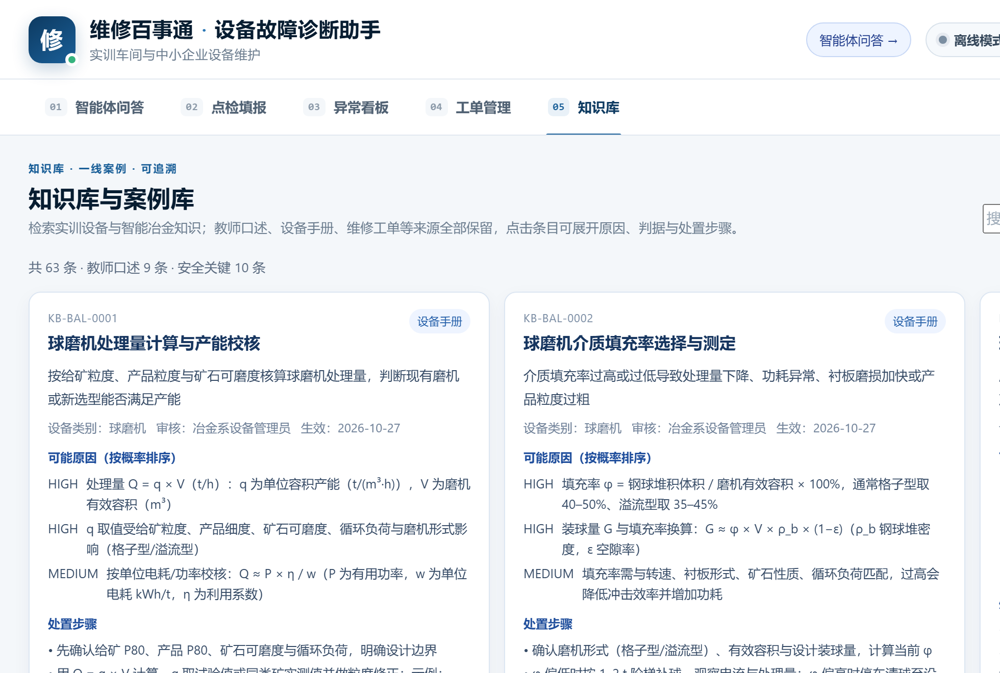

# 一、项目背景：来自智能冶金系实训现场的真实需求

日照职业技术大学智能冶金系面向冶金智能装备、工业互联网与设备运维培养技术技能人才。系部实训中心拥有车床、加工中心、3D 打印、激光、空压机、电机、配电、连铸、加热炉、轧机、除尘风机、液压站、电弧炉、球磨机、回转窑、浓密机等多类设备，设备台账与维护任务逐年增加。

当前主要痛点：

- 设备说明书、维修手册、故障案例分散在纸质文档、教师经验和个别工单中，学生遇到问题时难以快速检索；
- 新学生排查依赖教师口头指导，步骤不统一，点检记录与异常处理难闭环；
- 通用大模型直接回答设备问题容易编造参数、引用不可追溯，不能直接用于实训现场；
- 工业互联网专业需要“设备数据 + 智能体”的落地载体，把采集、诊断、处置与知识沉淀串起来。

本项目以智能冶金系实训设备为原型，建设“维修百事通”设备故障诊断与点检智能体，服务系部实训教学、设备管理与区域中小企业设备运维。

# 二、建设定位与目标

**定位**：面向智能冶金系的“设备知识库 + 智能体问答 + 点检闭环”一体化教学与实训工具，形成“教学—实训—社会服务”三位一体的应用载体。

| 阶段 | 目标 |
| --- | --- |
| 近期（2026） | 覆盖智能冶金系实训中心 16 台典型设备、63 条知识与 119 项点检，完成系部试点 |
| 中期（2027） | 知识扩容至 100 条以上，接入系部设备台账与工单流程，支撑工业互联网专业课程案例 |
| 长期 | 形成可复制到区域冶金与装备制造企业的设备运维智能体，预留工业互联网数据接口 |

# 三、系部场景与目标用户

| 用户 | 场景 | 价值 |
| --- | --- | --- |
| 智能冶金系实训学生 | 故障现象问答、排查引导、点检填报 | 按标准步骤排查，先安全后操作 |
| 系部教师/设备管理员 | 异常看板、工单派发与结案、知识复核 | 掌握设备状态，沉淀教学案例 |
| 工业互联网专业学生 | 智能体工具编排、数据与知识库、部署运维 | 真实项目式学习载体 |
| 区域中小企业设备班组 | 点检标准化、故障经验留存、维修闭环 | 低成本设备运维数字化起步 |

核心流程：学生描述现象 → 智能体路由到知识诊断/排查引导/点检/看板/工单工具 → 给出原因排序、判定依据、处置步骤、风险与引用 → 点检异常汇总 → 建单/结案 → 知识候选回流系部知识库。

{width=15.5cm}

# 四、功能与技术方案

| 模块 | 内容 |
| --- | --- |
| 智能体工具 | 知识库诊断、排查引导、点检清单、异常看板、工单流转、设备台账 |
| 知识库/案例库 | 按设备类别与来源检索 63 条知识，展开原因、判据、处置步骤、风险与来源；教师口述案例可追溯 |
| 知识库 | 16 台设备、63 条知识、119 项点检、5 棵决策树；每条含来源、审核人、生效日期与安全等级 |
| 检索增强 | 关键词 BM25 + 512 维字符哈希向量混合召回；可切换远端 Embedding |
| 大模型 | 可选接入自定义模型 Z（deepseek-v4.1-flash）；提示词运行时加载 WXBST-SYS-001/QA-001，异常自动回退离线 |
| 安全 | 危险请求拦截、提示词注入防护、引用校验、审计与限流 |
| 产品化 | SQLite WAL 持久化、Token 鉴权、/api/ready 与 /api/metrics、备份恢复、Docker/nginx/systemd |
| 工业互联网接口（规划） | 预留 OPC UA/Modbus/SCADA 数据接入与工单系统对接，R2 起逐步落地 |

# 五、与智能冶金系教学的融合

1. **课程案例**：作为“冶金设备维护”“工业互联网数据采集”“智能体应用开发”等课程的 project-based 案例；
2. **实训管理**：点检清单与异常看板直接用于系部实训室日常管理，工单结案形成教学案例；
3. **学生参与**：学生参与设备台账整理、知识条目校对、评测用例编写与系统测试，理解“数据—知识—智能体—现场”的完整链路；
4. **岗课赛证融通**：对标设备点检、工业互联网运维等岗位能力，支撑技能竞赛与 1+X 证书训练；
5. **教师成长**：教师访谈与知识复核沉淀为系部教学资源，减少重复口头指导。

# 六、数据与验证

| 维度 | 规模 |
| --- | --- |
| 设备台账 | 16 台（7 类实训 + 9 类智能冶金） |
| 知识条目 | 63 条（含 28 条智能冶金、14 条通用设备） |
| 点检模板 | 119 项 |
| 诊断决策树 | 5 棵 / 63 节点 |
| 评测用例 | 78 条 |

验证结果：评测 78/78、离线垫片 43/43、工业门禁 53/53、生产基础验收 31/31；危险请求拦截与提示词注入拒答均为 100%。数据为实训教学样例，落地时替换为系部真实手册与教师访谈。

# 七、建设计划

| 时间 | 任务 | 交付 |
| --- | --- | --- |
| 2026 Q4 | 系部实训中心试点；完善 16 台设备知识库；教师培训 | 系部试点报告、使用手册 |
| 2027 Q1 | 知识扩容至 100 条；接入系部设备台账与工单；R2 登录/RBAC | 系部版系统、课程案例包 |
| 2027 Q2 | 工业互联网数据接口试点；学生项目组；校级推广 | 数据接口规范、校级案例 |
| 2027 Q3-Q4 | 区域中小企业试点；形成可复制方案 | 社会服务案例、总结报告 |

# 八、团队与保障

| 姓名 | 角色 | 职责 |
| --- | --- | --- |
| 张庆涛 | 项目负责人（智能冶金系 工业互联网） | 总体设计、知识库、智能体编排、系部协调与答辩 |
| 张海波 | 指导教师 | 设备场景审核、知识复核、安全把关、教学指导 |
| 刘宝硕 | 团队成员 | 前端交互、点检/看板、测试 |
| 刘信泽 | 团队成员 | 检索引擎、数据整理、部署运维 |

保障：依托智能冶金系实训中心设备与教师资源；采用离线优先、低成本部署，先在系部机房/实训室边缘服务器运行，数据不出校；按学校数据治理与安全要求逐步推广。

# 九、预期成果与应用价值

- **教学成果**：形成 1 套可复用的实训故障诊断与点检案例，支撑 3 个班级试点；
- **知识资产**：建成系部设备知识库与教师访谈库，形成“维修—沉淀—复用”闭环；
- **学生能力**：学生掌握设备诊断、点检、智能体与工业互联网运维的复合技能；
- **社会服务**：为日照区域冶金与装备制造中小企业提供低成本设备运维数字化方案；
- **可持续**：每学期更新知识、每季度复盘故障案例，工单结案自动进入知识候选池。

# 十、风险与应对

| 风险 | 应对 |
| --- | --- |
| 知识来源不真实或过期 | 来源、审核人、生效日期齐全；双人复核，过期下架不删除 |
| 大模型编造参数 | 证据过滤 + 引用校验 + 安全拦截；模型异常自动回退离线 |
| 现场操作安全 | 危险请求先停机断电；排查树设安全确认门；高风险动作要求教师/值班人员确认 |
| 部署与运维门槛 | 提供离线单文件、Docker/nginx/systemd 与备份脚本；系部先试点再推广 |
| 数据隐私 | 仅使用教学样例与公开手册；访谈稿匿名化，不采集企业敏感数据 |

> 说明：本方案中的设备与知识为智能冶金系实训教学样例，落地时替换为系部真实手册与教师访谈；系统可按学校数据治理要求部署在校内服务器或私有云。
